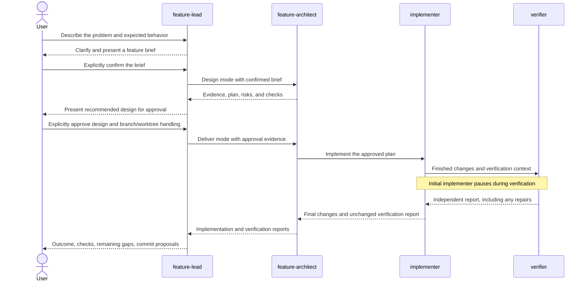
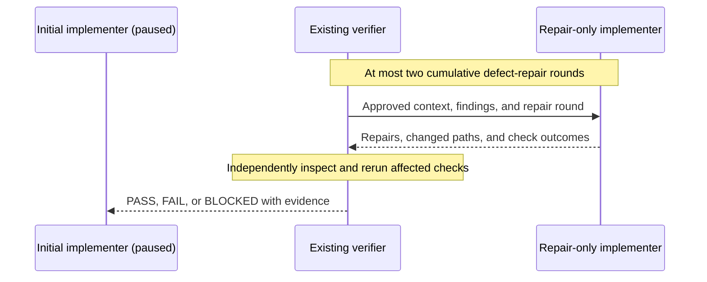
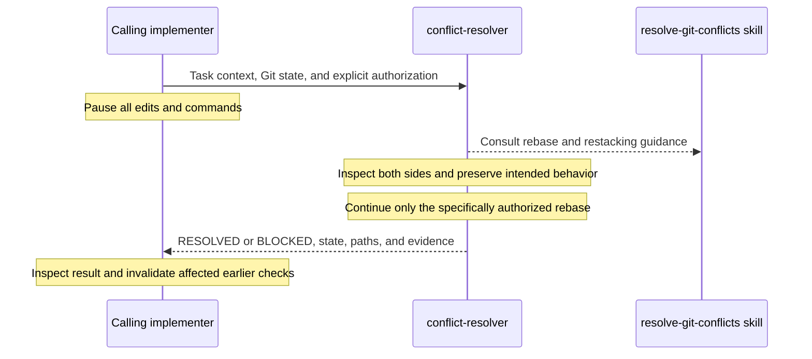
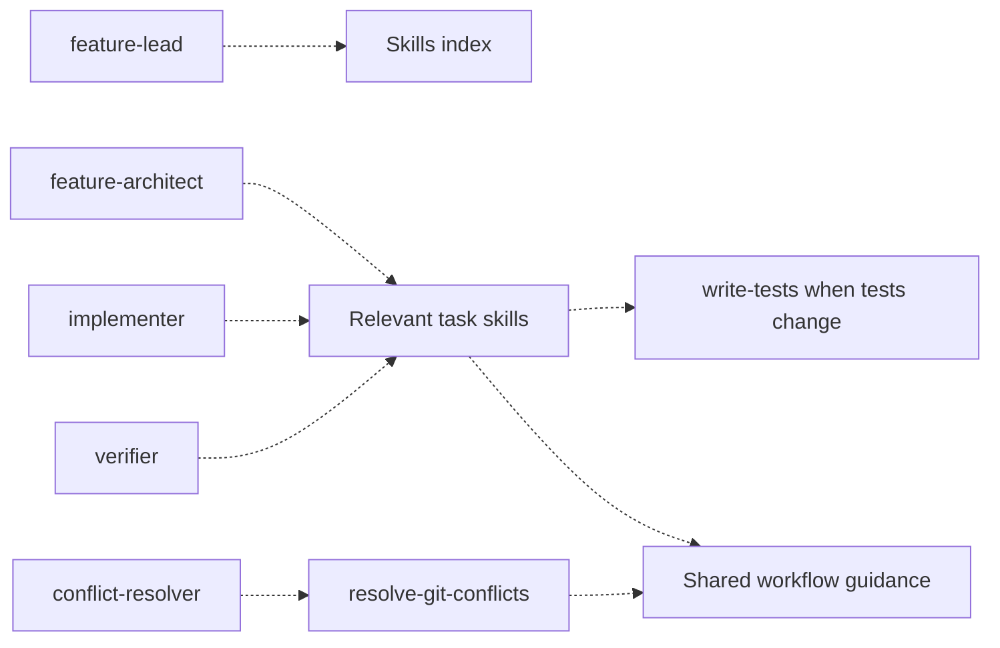

# What is this?

<a id="what-is-this"></a>

A practical introduction to this project's AI agents and skills: who does what,
how work moves between them, and where you stay in control. Start here if the
agent profiles and skill files feel too detailed.

This is a visual explanation, not a new workflow or permission grant. The
[agent workflow reference](FEATURE_AGENTS.md) defines the detailed contracts,
and the [skills index](../.github/skills/README.md) lists available workflows.
[Repository instructions](../AGENTS.md) still apply.

## Table of Contents [ᐞ](#table-of-contents)

<a id="table-of-contents"></a>

* [What is this](#what-is-this)
  * [Table of Contents](#table-of-contents)
    * [Agents versus skills](#agents-versus-skills)
    * [Meet the agents](#meet-the-agents)
    * [From request to verified result](#from-request-to-verified-result)
    * [When verification finds a problem](#when-verification-finds-a-problem)
    * [When branches conflict](#when-branches-conflict)
    * [How skills support the agents](#how-skills-support-the-agents)
    * [Choose a starting skill](#choose-a-starting-skill)
    * [Your first request](#your-first-request)
    * [Reading the outcome](#reading-the-outcome)
    * [Where to go next](#where-to-go-next)

## Agents versus skills [ᐞ](#table-of-contents)

<a id="agents-versus-skills"></a>

Think of **agents as teammates with defined jobs** and **skills as playbooks
they can consult**. An agent has a role, allowed tools, and rules for handing
work to another agent. A skill describes how to approach a particular kind of
task using this repository's patterns.

| Concept | Answers | Example |
| --- | --- | --- |
| Agent | Who owns this step? | `verifier` checks independently. |
| Skill | How should we approach it? | `write-tests` explains testing. |
| Repository instructions | What rules apply? | Preserve unrelated work. |
| Client tools | What can run here? | Editing, commands, delegation. |

A skill is not another agent, does not run itself, and cannot grant tools or
approve changes. Using a skill does not automatically start the feature-agent
chain. The diagrams below describe the intended workflow, not a guarantee that
every Copilot client supports it.

Diagrams use Mermaid, as in the
[CI execution guide](GITHUB_WORKFLOWS.md#core-ci-execution). View this page on
GitHub or in a Mermaid-capable Markdown preview. Each diagram has a prose
explanation so the guide also works when diagrams appear as source text.

## Meet the agents [ᐞ](#table-of-contents)

<a id="meet-the-agents"></a>

You select **feature-lead** and stay in that conversation. The other agents
are hidden specialists, called only through their approved routes.

| Agent | Plain-language job | Important boundary |
| --- | --- | --- |
| [feature-lead](../.github/agents/feature-lead.agent.md) | Your point of contact: clarifies the request, asks for approvals, reports the result. | Does not edit files or run commands. |
| [feature-architect](../.github/agents/feature-architect.agent.md) | Studies the repository and proposes a concrete design. | Does not implement; delegates only an approved plan. |
| [implementer](../.github/agents/implementer.agent.md) | Writes the approved changes, tests, and related documentation. | Pauses during verification and delegated conflict work. |
| [verifier](../.github/agents/verifier.agent.md) | Independently inspects and checks the final result. | Does not edit or run fixers. |
| [conflict-resolver](../.github/agents/conflict-resolver.agent.md) | Resolves authorized Git rebase conflicts without losing either side's intent. | Called only by an implementer; cannot delegate or publish. |

Tool lists help clients expose the right capabilities; they are not security
isolation. Actual discovery, tools, and nesting vary by client. See
[compatibility and limitations](FEATURE_AGENTS.md#compatibility-and-limitations)
before relying on the chain.

## From request to verified result [ᐞ](#table-of-contents)

<a id="from-request-to-verified-result"></a>

There are **two separate approval stops**: confirming what you want, then
approving how to build it. Branch/base selection and handling of existing work
must also be authorized before changes begin.



The architect is called first to design, then again to deliver the approved
plan. Reports return through existing callers; nobody starts another lead.
A detailed original request is not a substitute for either approval.
If the approved design no longer fits, the lead brings the decision back to
you instead of allowing a specialist to silently change scope.

## When verification finds a problem [ᐞ](#table-of-contents)

<a id="when-verification-finds-a-problem"></a>

The verifier can ask a **separate repair-only implementer** to fix a concrete,
in-scope defect. The original implementer stays paused. The repair worker
returns to the same verifier, which inspects and checks the repairs itself.



The repair worker must not start a new verifier. Restarting or resuming a task
does not reset the two-round budget. More rounds, changed requirements, or
design changes need explicit user authorization through the lead.

Every handoff carries the relevant approvals, original baseline, accumulated
changes, findings, and repair history. Think of this as the task's shared
case file: a repair must not forget earlier work or treat it as unrelated.

## When branches conflict [ᐞ](#table-of-contents)

<a id="when-branches-conflict"></a>

Conflict resolution is a **rebase workflow, not branch synchronization by
merge**. It applies when rebasing onto an approved base or restacking a child
after its parent changes. Conflicting requirements still go to the lead.
An active merge requires an authorized recovery decision, not automatic
continuation.



The skill interaction is a reference lookup, not delegation to another worker.
The resolver cannot invoke agents or push changes. Approving conflict edits
alone does not authorize starting or continuing a rebase. Unclear intent,
missing authorization, or unavailable required tooling stops the work with
the exact partial Git state reported.

In initial mode, the implementer returns resolved work to verification. In
repair-only mode, it returns to the **existing verifier**. Resolving conflicts
does not reset the repair budget, and `RESOLVED` does not mean verifier `PASS`.

For stacked PRs, preserve the old parent tip and replay only the child's
commits onto the new target. Merge the parent PR first, then retarget/restack
the child as described in the
[stacked PR procedure](REQUIRED_CHECKS.md#stacked-pull-requests).
Merging a parent PR is distinct from merging a base branch into a conflicted
task branch. See the
[conflict skill](../.github/skills/resolve-git-conflicts/SKILL.md) for safeguards.

## How skills support the agents [ᐞ](#table-of-contents)

<a id="how-skills-support-the-agents"></a>

Agents select references by the work at hand, not by a fixed one-skill-per-agent
assignment. The same skill can help the architect plan, the implementer build,
and the verifier understand what needs checking.



Here **dotted arrows mean consultation, not agent calls or mandatory execution
order**. The design-only architect does not run a skill's implementation steps.
The verifier does not gain editing permission by reading a skill.

Skills remain supporting references: missing skill-selection records do not
block delivery or verification. Actual approvals and required evidence still
matter, and any host requirement for native skill invocation still applies.
Consulting a skill does not require running every command mentioned in it;
checks are selected from the actual changes and affected behavior.

## Choose a starting skill [ᐞ](#table-of-contents)

<a id="choose-a-starting-skill"></a>

These are common entry points, not another complete inventory. Follow the
[skills index](../.github/skills/README.md#available-skills) for every skill and
its precise trigger.

| Your task | Start with | Add references for the layers actually changing |
| --- | --- | --- |
| Add a CRUD API resource | [add-rest-resource](../.github/skills/add-rest-resource/SKILL.md) | Entities/migrations, DTO mapping, queries, security, and tests. |
| Add a non-CRUD endpoint | [add-custom-api-endpoint](../.github/skills/add-custom-api-endpoint/SKILL.md) | Input validation, authentication, response contract, and OpenAPI. |
| Diagnose a failure | [debug](../.github/skills/debug/SKILL.md) | The affected subsystem and [write-tests](../.github/skills/write-tests/SKILL.md) for regression coverage. |
| Change authentication or permissions | [implement-api-authentication](../.github/skills/implement-api-authentication/SKILL.md) | [add-security-voter](../.github/skills/add-security-voter/SKILL.md) for subject-based decisions. |
| Change developer scripts or Make targets | [maintain-development-tooling](../.github/skills/maintain-development-tooling/SKILL.md) | Container boundaries and script regressions. |
| Change containers or CI behavior | [update-docker-environment](../.github/skills/update-docker-environment/SKILL.md) or [update-github-workflows](../.github/skills/update-github-workflows/SKILL.md) | Image-pin and Action-pin skills only when those inputs change. |
| Update dependencies | [update-dependencies](../.github/skills/update-dependencies/SKILL.md) | Runtime baseline or Symfony recipes when affected. |
| Maintain agents or skills | [maintain-ai-guidance](../.github/skills/maintain-ai-guidance/SKILL.md) | Contract/routing review and documentation checks. |
| Resolve a rebase conflict | [resolve-git-conflicts](../.github/skills/resolve-git-conflicts/SKILL.md) | Explicit Git authorization and affected behavior checks. |

For example, adding a resource with a new entity and input validation may use
several skills. Changing a DTO alone should not trigger resource scaffolding,
a migration, or a full unrelated test suite.

## Your first request [ᐞ](#table-of-contents)

<a id="your-first-request"></a>

Open the repository in a supported Copilot client and select `feature-lead`.
Check the [client setup and limitations](FEATURE_AGENTS.md#using-the-agents)
first if agents or tools are missing. Paste a concrete request such as:

```text
Add an authenticated endpoint that returns the current user's timezone.
Expected behavior: return the saved timezone, using the existing API format.
Acceptance criteria: authenticated requests succeed; anonymous requests fail.
Non-goals: no user-editing endpoint and no new authentication mechanism.
Please clarify the brief and propose a design before implementation.
```

This is an example request, not approval to implement it. Answer the lead's
questions, confirm the brief, review the design, and authorize branch/base
selection and existing-work handling. Remain in the lead conversation; do not
select a hidden specialist to bypass a stop.

If development services are stopped, start them from the repository root on
the Docker host before requesting implementation:

```bash
make daemon
```

If the host cannot support required nested delegation, the workflow reports
`BLOCKED`; profiles cannot enable unsupported capabilities. The deepest
repair-only conflict resolver reaches nesting level five in VS Code Local.
That limit is not a claim of equivalent support in CLI or JetBrains.

## Reading the outcome [ᐞ](#table-of-contents)

<a id="reading-the-outcome"></a>

| Result | What it tells you |
| --- | --- |
| Verifier `PASS` | Criteria verified, checks passed, no actionable findings. |
| Verifier `FAIL` | Actionable defects remain. |
| `BLOCKED` | Missing approval, evidence, tooling, or a necessary decision. |
| Resolver `RESOLVED` | Rebase finished; verification still needed. |

A useful handoff names the changed files, exact checks and results, findings
and repairs, and remaining gaps. Read "not verified" literally: passing Markdown
checks does not prove that a client discovers agents or delegates correctly.
Implementation success alone is not independent verification. A blocker report
must preserve known defects, not hide them behind missing evidence.

When resuming blocked work, keep the same approved context, original baseline,
accumulated changes, and repair count. Resolve the specific blocker with the
lead instead of asking another specialist to start over.

## Where to go next [ᐞ](#table-of-contents)

<a id="where-to-go-next"></a>

* [Agent workflow reference](FEATURE_AGENTS.md): permissions, handoffs, client
  setup, tool diagnostics, and validation details.
* [Skills index](../.github/skills/README.md): all playbooks and when to use them.
* [Shared guidance](../.github/skills/shared-guidance.md): branches, worktrees,
  checks, and final handoffs.
* [AI maintenance policy](AI_RULES.md): where new guidance belongs and how to
  avoid duplicate rules.
* [Validation selection](TESTING.md#selecting-validation): choose checks for
  the behavior and files actually affected.

---

[Back to previous](README.md)

[Back to main README.md](../README.md#ai-assisted-development)
