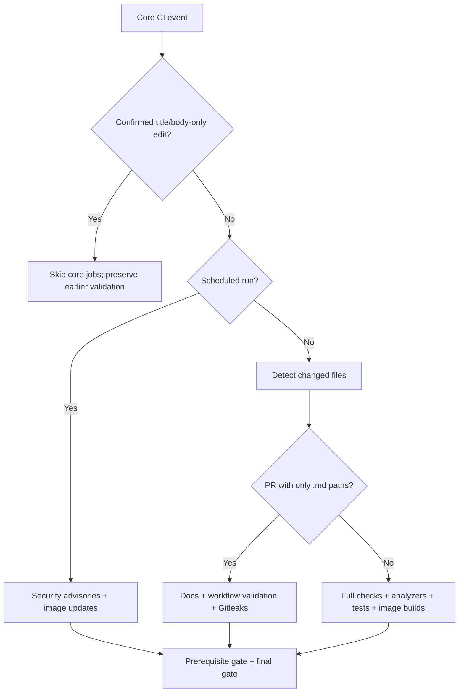
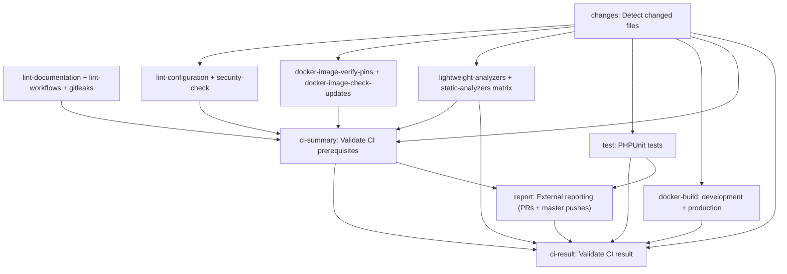
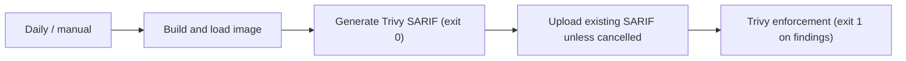

# What is this?

<a id="what-is-this"></a>

This guide explains what GitHub Actions checks, when each workflow runs, and
where to look when a run fails. Start with the event tables; use the graphs
and job reference when maintaining CI.

Workflow YAML in `.github/workflows/` is the source
of truth for execution.
[Required checks and branch protection](REQUIRED_CHECKS.md)
owns merge policy and GitHub settings; this guide does not replace it.
Nothing here deploys the application or publishes application images.

## Table of Contents [ᐞ](#table-of-contents)

<a id="table-of-contents"></a>

* [What is this](#what-is-this)
  * [Table of Contents](#table-of-contents)
    * [Quick start](#quick-start)
    * [When workflows run](#when-workflows-run)
    * [Core CI execution](#core-ci-execution)
      * [Choosing the validation path](#choosing-the-validation-path)
      * [Job dependency graph](#job-dependency-graph)
      * [Job reference](#job-reference)
      * [Gates and cancellation](#gates-and-cancellation)
    * [Containers and test setup](#containers-and-test-setup)
    * [Security and maintenance workflows](#security-and-maintenance-workflows)
    * [Reports and artifacts](#reports-and-artifacts)
    * [Reproducing checks locally](#reproducing-checks-locally)
    * [Troubleshooting](#troubleshooting)
    * [Maintaining this guide](#maintaining-this-guide)

## Quick start [ᐞ](#table-of-contents)

<a id="quick-start"></a>

Open the repository's **Actions** tab, choose a workflow, then open its run.
The run graph shows job status; selecting a job opens its step logs.
The run summary contains downloadable artifacts and any generated summaries.
Security analysis results are also available under **Security > Code scanning**.

For pull requests, start with the **Checks** tab:

* Wait for `Validate CI result` and `dependency-review`, the two required
  checks. The first summarizes core CI; the second is a separate workflow.
* If the aggregate gate fails, inspect the failed upstream job, not just the
  aggregate's final `test` command.
* Markdown-only PRs intentionally skip application tests and image builds.
  Editing only a PR title or body does not repeat core validation.
* A green PR does not imply the daily image scan or external uploads ran.
  The scan has separate triggers; uploads require tokens, and Markdown-only
  PRs skip reporting. Eligible reporting is enforced by the core gate.

To run a workflow manually, select it under **Actions > Run workflow**, choose
the branch and confirm. Only workflows with `workflow_dispatch` expose this
button. A manual run executes real jobs; it is not a dry run.

## When workflows run [ᐞ](#table-of-contents)

<a id="when-workflows-run"></a>

PR means a pull request targeting **any branch**, including a stacked PR's
parent. A push means a push to `master`; pushes to feature branches alone do
not trigger these push filters. Workflows run independently: there is no
cross-workflow dependency on core CI.

| Workflow and source | Automatic events | Manual |
| --- | --- | --- |
| [CI][ci] | PR, push, merge group, daily | Yes |
| [Dependency Review][dependency-review] | PR, merge group | No |
| [CodeQL][codeql] | PR, push, weekly | Yes |
| [Scorecard][scorecard] | Push, weekly, protection rule | Yes |
| [Vulnerability Scan][vulnerability-scan] | Daily | Yes |

[ci]: ../.github/workflows/main.yml
[dependency-review]: ../.github/workflows/dependency-review.yml
[codeql]: ../.github/workflows/codeql.yml
[scorecard]: ../.github/workflows/scorecard.yml
[vulnerability-scan]: ../.github/workflows/vulnerability-scan.yml

Core CI explicitly handles PR `opened`, `synchronize` (new commits),
`reopened` and `edited` events. Dependency Review and CodeQL use the default
PR activity types: `opened`, `synchronize` and `reopened`; they do not rerun
just because the PR title/body was edited. Both core CI and Dependency Review
handle `merge_group: checks_requested` for merge-queue validation.
Scorecard also handles `branch_protection_rule` events.

All cron times below are **UTC**, not local time. GitHub schedules run on the
default branch and may be delayed; they are not exact-time guarantees.

| Workflow | Schedule | Work performed |
| --- | --- | --- |
| CI | Daily, 00:00 (`0 0 * * *`) | Dependency advisories, image updates |
| Vulnerability Scan | Daily, 12:00 (`0 12 * * *`) | Both image builds/scans |
| CodeQL | Monday, 03:30 (`30 3 * * 1`) | GitHub Actions analysis |
| Scorecard | Friday, 09:29 (`29 9 * * 5`) | Supply-chain assessment |

Core CI's schedule also runs its two aggregate gates to validate the periodic
results. It does **not** run PHPUnit, PHP analyzers or the core image-build
matrix. A manual CI run, unlike a scheduled one, runs full validation even
when the selected branch changes only Markdown, but skips external reporting.

## Core CI execution [ᐞ](#table-of-contents)

<a id="core-ci-execution"></a>

### Choosing the validation path [ᐞ](#table-of-contents)

<a id="choosing-the-validation-path"></a>

This decision graph applies only to [core CI](../.github/workflows/main.yml).
Other workflows retain their own triggers.



Only a nonempty, successful PR diff containing exclusively paths ending in
`.md` reports `code=false`. Change detection uses the PR base/head comparison
and disables rename detection, so both old and new paths count. Renaming PHP
to Markdown still runs full CI. An empty/unclear diff counts as code; a failed
detection job cannot authorize skips. Push, manual and merge-group events
always count as code.

A confirmed metadata edit has a title/body change and no base change in its
payload. Base changes and unclear edits validate normally. The metadata run
uses the distinct skipped context `Metadata-only PR edit (no validation)`;
it must never satisfy or replace `Validate CI result`.

### Job dependency graph [ᐞ](#table-of-contents)

<a id="job-dependency-graph"></a>

Arrows show `needs` relationships, **not** an instruction to run jobs serially.
Grouped boxes represent jobs sharing the same dependency. This is the full
validation path; the event rules above decide which jobs actually run.



Tests and image builds start after successful change detection, **without
waiting for prerequisite checks**. This gives earlier feedback but can spend
compute even if lint or security checks subsequently fail. External reporting
waits for successful tests and the prerequisite gate. Eligible reporting must
succeed for the final merge gate to pass. Dependency Review is separate from
this graph and is required too.

### Job reference [ᐞ](#table-of-contents)

<a id="job-reference"></a>

The IDs below are the YAML keys, useful when reading `needs` and conditions.
Display names appear in GitHub's run graph and logs.

| Job ID | Responsibility |
| --- | --- |
| `changes` | Detect whether a PR changes anything beyond Markdown |
| `lint-documentation` | Markdown style, skill metadata, local links/anchors |
| `lint-workflows` | Workflow syntax, shell, security and action metadata |
| `gitleaks` | Scan for committed secrets |
| `lint-configuration` | Composer, runtime, YAML, routing and Compose checks |
| `security-check` | Symfony security checker and `make check-security` |
| `docker-image-verify-pins` | Verify multi-platform base-image pins |
| `docker-image-check-updates` | Helper regressions and advisory update lookup |
| `lightweight-analyzers` | CodeSniffer, ECS, PHPLint, Parallel Lint, PHPLoc |
| `static-analyzers` | Separate Psalm, PHPStan and PHP Insights matrix jobs |
| `test` | PHPUnit, coverage and PhpMetrics reports |
| `docker-build` | Build and Trivy-scan development and production images |
| `ci-summary` | Validate expected prerequisite results |
| `report` | Coveralls/SonarCloud uploads; eligible job must succeed |
| `ci-result` | Validate the combined core CI result |

Documentation, workflow validation and Gitleaks have no dependency on change
detection and remain enabled for Markdown-only PRs. All application checks,
including PHP security and Docker pin/update checks, skip those PRs.

`lint-workflows` runs actionlint with ShellCheck, zizmor security auditing,
local composite-action schema validation and offline tooling regressions.
`make lint-yaml` checks Symfony configuration, not GitHub workflows.

Lightweight tools have separate steps sharing one bootstrap; later tools
still run after earlier tool failures if setup succeeded and the job was not
cancelled. Both analyzer and image-build matrices use `fail-fast: false`, so
one failing variant does not cancel the others.

### Gates and cancellation [ᐞ](#table-of-contents)

<a id="gates-and-cancellation"></a>

`ci-summary` checks every prerequisite result. `ci-result` checks change
detection, the prerequisite gate, both analyzer jobs, PHPUnit, the Docker
matrix and external reporting. Application jobs must succeed except on
schedules and confirmed Markdown-only PRs. Reporting must succeed on code PRs
and `master` pushes; it must be skipped on schedules, manual runs, merge groups
and Markdown-only PRs. A skipped job is not general permission to merge.

Both gates use `!cancelled()`: failed/skipped dependencies still reach their
result checks, but cancellation stops the gates. Periodic security/update
jobs also use this guard to run despite scheduled change detection being
skipped. Container cleanup steps use `always()`.

Core CI cancels older runs in the same workflow/ref concurrency group.
Schedules have a separate `-schedule` group; confirmed metadata edits have a
separate `-metadata` group. Neither can cancel ordinary validation on the
same ref. CodeQL has its own workflow/ref cancellation group. The other
workflows do not declare concurrency groups.

## Containers and test setup [ᐞ](#table-of-contents)

<a id="containers-and-test-setup"></a>

All jobs use Ubuntu runners. Most PHP/tooling jobs share
[`php-bootstrap`](../.github/actions/php-bootstrap/action.yml), which builds
the development Docker target and starts the Compose PHP service without
the application entrypoint. PHP, extensions and coverage tooling come from
the development image, not a separate runner PHP installation.

By default, bootstrap installs Composer dependencies and prints tool versions.
Documentation/workflow checks and image-update checks disable both.
Tests defer installation and version output until CI configuration and JWT
keys exist. Tests and reporting opt into Composer download caching despite
deferring installation; cache keys include all Composer lockfiles.

Project Make targets execute in the Compose PHP development container.
Docker/Buildx, registry authentication, GitHub actions and artifact operations
run on the runner host. See the
[development guide](DEVELOPMENT.md#continuous-integration)
for cache boundaries and container-routing details.

The PHPUnit job starts a health-checked MariaDB service, copies CI environment
templates, generates JWT keys, installs dependencies and runs
`make run-tests-php`. MariaDB's dynamically assigned host port is forwarded
to the PHP container through `host.docker.internal`; it does not use a
developer's persistent database volume. Do not reproduce this setup by
overwriting local environment files or running `make configure-ci` locally.

## Security and maintenance workflows [ᐞ](#table-of-contents)

<a id="security-and-maintenance-workflows"></a>

**Dependency Review** compares dependency changes for known vulnerabilities.
The action selects PR or merge-group base/head revisions natively. This is
the separately required `dependency-review` context, not a full installed
dependency audit or an image scan.

**CodeQL** analyzes GitHub Actions (`languages: actions`, no build).
It does not analyze PHP. Results go to code scanning; PHP analysis is covered
by the core analyzer jobs and optional SonarCloud reporting.

**Scorecard** assesses repository supply-chain practices, publishes results
to OpenSSF for this public repository, and uploads SARIF to artifacts and
code scanning. It does not run on ordinary PRs and is not required for merging.

**Vulnerability Scan** builds both Docker targets independently of core CI.
The graph below shows the steps for each matrix target:



Both this workflow and core image builds enforce fixable `CRITICAL,HIGH`
OS/library vulnerabilities with Trivy; unfixed findings are ignored.
The separate SARIF generation step does not enforce the threshold: the later
scan does. Image-scan reports can therefore be available even when enforcement
fails. Earlier build/report/upload failures can prevent later steps.

Both workflows build and load images locally, with `push: false`. Core builds
read target-specific GitHub Actions caches and write them only on `master`
pushes. Scheduled vulnerability scans disable build cache; manual scans may
read core image caches. Builds pull base images and bypass the production
stage cache. Bootstrap similarly disables cache on schedules and writes its
own cache only on `master` pushes.

Docker **update availability** in core CI is advisory: newer stable images
produce warnings and a maintenance summary, not a failing gate.
Registry/checker errors, invalid pins and helper regression failures still
fail. Pin verification and vulnerability enforcement remain blocking.
See [Docker image maintenance](DOCKER_MULTI_PLATFORM.md) for update procedures.

## Reports and artifacts [ᐞ](#table-of-contents)

<a id="reports-and-artifacts"></a>

| Producer | Artifact/result | Retention |
| --- | --- | --- |
| Lightweight analyzers | `phploc.json` | 14 days |
| Psalm matrix job | `psalm.json` | 14 days |
| PHPUnit | `clover.xml`, `junit.xml` | 14 days |
| PHPUnit | `CodeCoverage`, `PhpMetrics` HTML reports | 14 days |
| Scorecard | `SARIF file` artifact | 5 days |
| CodeQL, Scorecard, image scan | Code scanning results | GitHub-managed |

Test reports originate in `build/logs/`, `build/report/` and
`build/phpmetrics/`. After PHPUnit succeeds or fails (unless cancelled), CI
checks required report files and attempts artifact uploads. Missing required
reports fail the job. The test/coverage job summary is informational and may
fail without failing the job; it does not replace the required artifacts.
PhpMetrics needs a usable JUnit report.

`External reporting` runs on PRs and `master` pushes after both tests and
`ci-summary` succeed, then downloads Clover/JUnit artifacts. Coveralls and
SonarCloud uploads each require their optional token; absent tokens skip the
corresponding upload. Fork PRs run the job without repository secrets and skip
uploads. Markdown-only PRs skip the job because tests and artifacts are skipped;
schedules, manual runs and merge groups also skip reporting.

The job installs and runs the isolated Coveralls tool in the Compose PHP
development container, forwarding its tokens and required GitHub CI metadata.
SonarCloud uses host-side report copies with relative source paths. Upload,
setup and artifact-download errors fail the reporting job and workflow;
eligible reporting must succeed for `Validate CI result` to pass even when
tokens are absent. No reports are uploaded to CodeClimate by the active workflow.

## Reproducing checks locally [ᐞ](#table-of-contents)

<a id="reproducing-checks-locally"></a>

From the repository root on the **Docker host**, start the development
environment if it is stopped:

```bash
make daemon
```

Then run the relevant checks from the same directory. These host-safe Make
targets forward tooling into the PHP container; select only the commands
covering your change:

```bash
make lint-markdown
make check-skills
make lint-workflows
```

For an application failure, run the matching tool instead:

```bash
make phpstan
make psalm
make run-tests-php
```

These are real checks, not a simulation of GitHub scheduling, permissions or
required contexts. `make lint-workflows` includes offline gate regressions but
does not execute hosted jobs. See
[validation selection](TESTING.md#selecting-validation)
for narrower tests and [branch protection](REQUIRED_CHECKS.md) for settings
verification. Never set CI environment flags locally to bypass setup guards.

## Troubleshooting [ᐞ](#table-of-contents)

<a id="troubleshooting"></a>

| Symptom | First place to look |
| --- | --- |
| Aggregate gate fails | Failed upstream job and gate result log |
| Tests/builds skipped | Event type, change detection and cancellation |
| Required context stays pending | Branch protection's exact check name |
| Image update job fails despite advisory mode | Lookup/pin/helper errors |
| No coverage upload on a PR | Prerequisite results, docs-only diff, tokens |
| Missing Coveralls/SonarCloud update | Reporting logs and optional tokens |
| Trivy report exists but job is red | Enforcement scan after SARIF upload |
| CodeQL default-setup conflict | Choose default setup or YAML, not both |

For an unexpected skip, open `Detect changed files` and inspect `Code changes`
in its log. On schedules and confirmed metadata edits the detection job itself
is intentionally skipped. Retitling a PR never repairs a failed validation.

To retry a transient failure, open the run under **Actions** and use
**Re-run failed jobs**. If the failure is reproducible, fix its cause and push
the change; do not make a required job optional just to turn CI green.
For stale required contexts, follow
[Changing required checks](REQUIRED_CHECKS.md#changing-required-checks).
Merge-queue trigger support does not mean the queue is enabled or live-tested;
see the [merge queue checklist](REQUIRED_CHECKS.md#merge-queue).

## Maintaining this guide [ᐞ](#table-of-contents)

<a id="maintaining-this-guide"></a>

When changing workflow triggers, conditions, `needs`, matrices or artifacts,
update the matching tables and graphs here. Update
[REQUIRED_CHECKS.md](REQUIRED_CHECKS.md) only when merge-policy guidance
changes. Keep action pin updates in the
[Actions update guide](ACTIONS_UPDATE.md).

This guide describes checked-in configuration, not evidence that every hosted
event, secret-dependent upload or GitHub setting has been exercised. Local
lint/link checks do not render Mermaid diagrams or prove hosted execution;
inspect the rendered graphs on GitHub when reviewing documentation.

---

[Back to previous](README.md)
